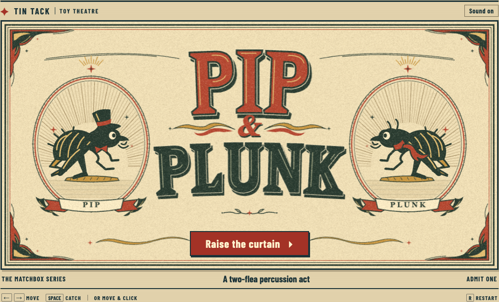

# Pip & Plunk



A two-flea percussion act from the Tin Tack Toy Theatre. Pip performs on the top face of a drum and Plunk performs upside down on the other. Every landing sends a wave to the partner’s feet. Catch it and the next flea takes flight.

Open the standalone HTML from the [GitHub release](https://github.com/EvanProgramming/pip-and-plunk/releases/latest) in a current browser to play offline.

## How to play

Choose **Raise the curtain**. Move the waiting flea beneath a bell on its side. When the wave reaches its feet, catch it to jump. For a high bell, let the wave go past, bounce off the rim and come back. Catch while moving to carry sideways momentum into the jump. A missed wave comes around again.

| Input | Move | Catch |
| --- | --- | --- |
| Keyboard | Left/right arrows or A/D | Space |
| Mouse | Move the pointer across the stage | Click |
| Touch | Drag across the stage | Release |

Press **P** or **Esc** to pause or resume, **R** to restart the act and **M** to toggle sound.

| Act | Bells | What to watch |
| --- | ---: | --- |
| I · Sound Check | 4 | Find a direct catch, then wait for a reflection to reach a high bell. |
| II · Loose Change | 6 | Line up with swinging bells and aim for where they'll be when the flea reaches them. |
| III · The Double Bill | 8 | Carry sideways speed through a pair of bells to ring both in one jump. |

For a touch restart, open Pause and choose **Restart this act**. Ring every bell in an act to advance. Clear the third act for the curtain call.

## Run, test and package

Run each command from this repository’s root. The runtime is plain HTML, CSS and JavaScript. Python 3.8+ serves and packages it. The model tests use Node.js 22.12+.

```sh
python3 -m http.server 8000 --bind 127.0.0.1 --directory game
```

Open [the local game](http://127.0.0.1:8000). The entry point is `game/index.html`.

```sh
node --test tools/model.test.mjs
python3 tools/build.py
```

To also produce a single-file offline edition, run `python3 tools/build.py --html ../pip-and-plunk.html`.

The build writes `../pip-and-plunk-itch.zip` with `index.html` at the archive root. It checks the entry list, file sizes and checksums. To choose a different destination, pass its path as the last argument, for example `python3 tools/build.py ./dist/pip-and-plunk.zip`.

## Design notebook

Five pitches explored the same question. What could come back changed after the player had let it go?

| Pitch | What the player does |
| --- | --- |
| Pottery echoes | Tap the sides of a clay pot so two echoes collide at a crack and mend it. |
| Creased glider | Crash a paper glider on purpose. The crease changes how it turns on the next throw. |
| The heckled singer | Catch a heckle from the cheap seats and sing it back as the missing note in a phrase. |
| Tidal orchard | Shake loose fruit at low tide and arrange branches to catch it on the returning water. |
| The flea percussion act | Land on one face of a drum to launch your partner from the other. A rim reflection makes a higher jump. |

The fleas earned the stage because the landing, handoff and next target are all visible at once. A low bell teaches the direct catch. A high bell gives the player a reason to pass up the first wave and listen for the rim. The final act asks what happens when the flea is already moving as the wave arrives.

## itch.io page copy

**Title**

Pip & Plunk

**Short description**

Two circus fleas share a drum. Catch your partner’s landing wave, ride the rim’s echo and ring the bells on both sides of the stage.

**Description**

Pip gets the top billing. Plunk works upside down. Between them sits one very good drum.

Slide under a bell and catch the wave from your partner’s last landing. Need a little more height? Wave it past and catch it on the way back. Moving at takeoff lets you sail sideways, which comes in handy when the final act books two bells for the price of one.

Three short acts, eighteen bells and a curtain call. Play with arrows and Space, move and click with a mouse, or drag and release on a touchscreen.

**Screenshot moments**

1. The opening poster with the **Raise the curtain** ticket visible.
2. A reflection at a drum rim with the waiting flea lined up below a high bell.
3. A flea swinging sideways through a pair of bells in *The Double Bill*.
4. Pip and Plunk taking their final bow beside the leap count.

**Upload**

1. Run `python3 tools/build.py`.
2. Create or edit an itch.io project, select **HTML** as its kind, and upload `pip-and-plunk-itch.zip` as the browser-playable file.
3. Choose **Embed in page** and start with a 960 × 640 viewport. Enable the fullscreen button. Add the copy and screenshots above.
4. Preview the draft and play through the embedded build. Check drag/release on a phone before marking the project mobile-friendly. [itch.io HTML5 upload guide](https://itch.io/docs/creators/html5)

## Playtest notes

The opening drop lands to one side so you can see the ripple before catching it. After playing the first three bells muted, we added a guide down to the drum and a brief name cue at handoff. The next improvement would be to watch first-time players discover the high jump without coaching, especially on a phone.

The release ZIP was unpacked and served from a nested directory inside a separate-origin iframe. Desktop Chrome completed all eighteen bells with keyboard and mouse, including two bells in one leap. The final verification run measured 16.7 ms median frame interval and 16.8 ms at the 95th percentile in the third act, with zero console errors or external requests. Touch drag/release and reduced motion were checked with mobile emulation. The standalone HTML also rang its first bell with the browser offline. Physical phone play and an itch-hosted session remain unverified.

## Credits and licenses

The game code, code-drawn artwork and original Web Audio music and effects are distributed under the [MIT License](LICENSE). Barlow Condensed is by the Barlow Project Authors and is bundled under the [SIL Open Font License 1.1](game/assets/OFL.txt).
